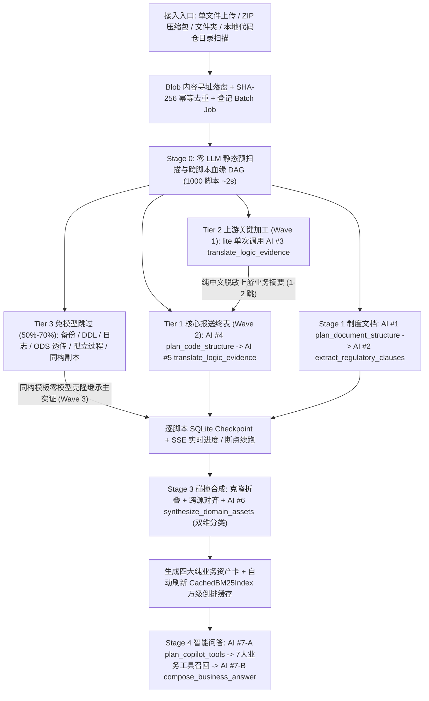

# Data Biz Copilot（`data-biz-copilot`）

> **统一 Data Agent 产品家族**：[`data-rule-studio`](https://github.com/shawhang0336-blip/data-rule-studio)（规则装配与验证） · [`data-biz-copilot`](https://github.com/shawhang0336-blip/data-biz-copilot)（业务资产与制度对账） · [`data-sql-guardian`](https://github.com/shawhang0336-blip/data-sql-guardian)（SQL 优化与发布门禁）

**代码隐身、业务显形** 的企业级监管/业务逻辑资产提取、对齐治理与智能问答工作台。

`Data Biz Copilot` 面向银行及金融机构监管报送（`1104` / `EAST 5.0` / `SAFE` / `PLUS` / `一表通` / `人行统计`）与复杂数仓工程场景：一边读入监管/业务制度文档，一边在后台静默解析成百上千份 SQL / 存储过程代码逻辑；物理表名、字段名、SQL 语句与脚本路径被严格封存为底层隐身实证依据，对外只产出 **100% 业务人员可读的纯中文业务资产**，并受 `Bus` 去技术化与实证白名单双重门禁硬性保护。

---

## 核心能力亮点

1. **五段式全链路流水线（Stage 0 → Stage 4）**
   - **Stage 0 零模型静态预扫描**：千级 SQL 工程 ~2 秒完成 `sqlglot` AST 解析、模板指纹聚簇与跨脚本「写表 → 读表」血缘 DAG 建图，自动三层分流砍掉 50%–70% 无效 AI 调用；
   - **Stage 1 制度文档双阶段提炼**：支持 `PDF` / `DOCX` / `XLSX` / `Markdown` / `TXT`，先做章节全局规划剔除前言废话，再分块提取结构化制度条款；
   - **Stage 2 拓扑波次异步解析与断点续跑**：按上游到下游拓扑顺序流式并发解析，每完成 1 个脚本即在主线程落盘一次 SQLite Checkpoint，支持两级预算保护、全局 RPM 限流、429 冷却退避、401/402/403 账单安全暂停与断点零重复续跑；
   - **Stage 3 双源碰撞对账与双维合成**：代码实证与监管条款按同体系精准对齐，产出四大纯业务资产卡（业务版图 / 处理规则 / 指标口径 / 制度对账），同时组织「垂直二级业务子专题 `sub_domain` × 水平金融十大主题 `subject_theme`」双维分类视图；
   - **Stage 4 纯业务 Data Copilot**：通过 7 个受控业务检索工具与万级规则内存倒排 BM25 缓存（`CachedBM25Index`）毫秒级召回，强制披露分歧（`DIVERGENT`）与未落地（`UNREALIZED`）事项，严禁模型编造或泄露任何底层技术词。
2. **严格架构与安全边界**
   - 后端严守 **8 层单向 DAG 依赖红线**（`infra -> kernel -> policy -> ingestion -> catalog -> copilot -> api -> main`），`kernel` 微内核零上层业务依赖，由 AST 自动化单测门禁守护；
   - 前端严守 **4 业务域对称结构**（`catalog` / `copilot` / `ingestion` / `platform`），所有 HTTP 调用隔离在 `src/api/`；
   - 压缩包批量上传内置 **Zip Slip 路径穿越**、符号链接与体积/数量上限防护。

---

## 端到端流程图（Stage 0 ~ Stage 4 与 7 个 AI 介入点）



### 7 个受控大模型介入点总览

| 编号 | 阶段 | Tool 契约名称 | AI 职责 | 核心输入与隔离边界 |
| :--- | :--- | :--- | :--- | :--- |
| **AI #1** | Stage 1 文档 | `plan_document_structure` | 识别文档类型与规范域名，划分章节角色（`RULE_CLAUSE / CALIBER_DEF / CAPABILITY_SCOPE / IGNORE`） | 仅看章节标题与摘要骨架 |
| **AI #2** | Stage 1 文档 | `extract_regulatory_clauses` | 按组提炼纯业务规范条款、适用角色与关联指标 | `document_plan` + 非 `IGNORE` 章节原文 |
| **AI #3** | Stage 2 上游 | `translate_logic_evidence`（`lite`） | 对 Tier 2 上游关键加工脚本单次直译，产出纯中文脱敏「上游业务摘要」 | 内存 `sql_logic_context`（不落对外表） |
| **AI #4** | Stage 2 核心 | `plan_code_structure` | 对多步 Tier 1 脚本划分 1–4 个逻辑阶段（`SCOPE_FILTER / CALCULATION / DEDUP_MERGE / IGNORE`） | **仅纯中文注释与无表名步骤 DAG**（严禁传入原始 SQL/表名/上游上下文） |
| **AI #5** | Stage 2 核心 | `translate_logic_evidence`（`full`） | 逐阶段精准还原纳入范围、剔除条件、计算算式、分支与防重粒度 | 内存 `sql_logic_context` + 脱敏 `upstream_business_context` |
| **AI #6** | Stage 3 合成 | `synthesize_domain_assets` | 融合制度条款与代码实证，润色规则/口径并校准 `sub_domain`（2–6 个/域）与 `subject_theme`（十大主题） | 分批规则草案、条款、实证及 `allowed_evidence_ids` 白名单 |
| **AI #7** | Stage 4 问答 | `plan_copilot_tools` + `compose_business_answer` | 先规划检索工具与横切维度，再基于召回资产与强制披露项生成对应角色口吻的专业答复 | 仅可访问业务资产与 `allowed_asset_codes` 白名单 |

> **关键确定性控制面（0 AI 调用）**：Phase 0 静态切块与指纹聚簇、Kahn 血缘拓扑与三层分流、滑动窗口调度与逐脚本 Checkpoint、父子两级预算级联回滚、全局 RPM 令牌桶与 429 冷却、401/402/403 余额不足安全暂停、事前去技术化门禁（`de_jargon_adjudicator`）与实证白名单门禁（`evidence_backing_adjudicator`）、`CachedBM25Index` 倒排检索。

---

## 双维业务分类体系

- **垂直条线分类**：`监管体系（1104 / EAST / SAFE / PLUS / 一表通 / 人行统计）` → `核心业务域` → `二级业务子专题 sub_domain`（单域约束 2–6 个凝聚专题）
- **水平跨报表金融十大主题（`subject_theme`）**：`当事人与客户`、`协议与账户`、`交易与事件`、`财务与余额`、`授信与押品`、`机构与组织`、`产品与业务`、`渠道与媒介`、`地域与跨境`、`风控与合规管控`

更多设计细节与层间边界见 [backend/ARCHITECTURE.md](backend/ARCHITECTURE.md)。

---

## 核心 API 接口一览

| 分组 | 方法与路径 | 说明 |
| :--- | :--- | :--- |
| **系统与运行观测** | `GET /api/health`、`GET /api/events/stream`、`GET /api/runs/{run_id}` | 健康检查、SSE 实时进度事件流、Run 账本与哈希链校验 |
| **模型与预算治理** | `GET/PUT /api/settings/llm-config`、`GET/PUT /api/settings/execution-budget` | 模型配置持久化（密钥脱敏）、并发数/RPM/单脚本调用上限/批总预算 |
| **双源接入与千级批处理** | `GET /api/sources`、`POST /api/sources/upload`、`POST /api/sources/load-sample`、`POST /api/sources/load-sac-real` | 单文件接入与演示/真实 SAC 语料一键载入 |
| **大批量工程控制台** | `POST /api/sources/batch-upload`、`POST /api/sources/import-dir` | 多文件/ZIP 安全解压或本地代码仓目录扫描，返回 Phase 0 三层预览 |
| **批任务控制与调级** | `GET /api/sources/jobs`、`GET /api/sources/jobs/{job_id}`、`PATCH /api/sources/jobs/{job_id}/materials/{material_id}/tier`、`POST /api/sources/jobs/{job_id}/{start\|cancel\|resume}` | 分页查看三层明细、手工覆盖分层、启动/中止/断点续跑/仅重试失败项 |
| **资产合成与治理** | `POST /api/sources/synthesize`、`GET /api/assets/panorama`、`GET /api/assets/{capabilities\|rules\|calibers\|reconcile}`、`PATCH/POST /api/assets/{rules\|calibers}/{id}/confirm`、`GET /api/assets/backing/{asset_code}` | 支持全量或 `target_domains` 增量合成、双维过滤、CAS 乐观锁人工确认 |
| **智能问答 Copilot** | `GET /api/copilot/tools`、`POST /api/copilot/ask`、`GET /api/copilot/sessions/{session_id}` | 7 个受控业务工具、多轮会话记忆与核验追溯 |

---

## 快速启动与验证

### 1. 环境配置
复制示例配置文件按需修改（默认 `llm_provider=scripted`，**无需真实 API Key 即可完整运行离线确定性引擎**；如需启用真实大模型，填入 OpenAI 兼容端点与密钥即可，`.env` 已被 `.gitignore` 排除）：

```bash
cp .env.example .env
```

### 2. 启动后端（推荐 Python 3.9+）
复用同级 `data-rule-studio/.venv` 或使用本地虚拟环境：

```bash
cd backend
../../data-rule-studio/.venv/bin/uvicorn app.main:app --host 127.0.0.1 --port 8010 --reload
```

### 3. 启动前端工作台

```bash
cd frontend
npm install
npm run dev
```

访问浏览器默认端口即可使用四大工作台页面：**双源接入与大批量断点控制台**、**纯业务资产全景与双维矩阵**、**Business Copilot 智能问答**、**模型与预算门禁设置**。

### 4. 运行离线全量测试与架构红线检查（0 外部模型调用）

```bash
# 后端全量测试（39 项：8 层单向 DAG 隔离 + Phase 0 分流 + 断点续跑 + 限流级联 + 万级 BM25 + 真实 SAC 语料 + 高并发 CAS）
cd backend
../../data-rule-studio/.venv/bin/pytest -v -W error::sqlalchemy.exc.SAWarning

# 前端规范审计（四域对称、fetch 严格隔离在 src/api/、纯业务标签无代码黑话）与生产构建
cd ../frontend
npm test && npm run build
```
